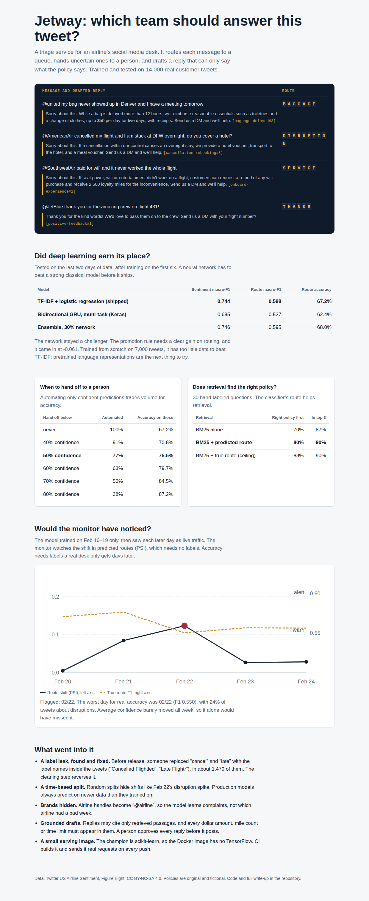

# Jetway

Triage for an airline's social media desk. Jetway reads each customer message, routes it to the right team, hands the uncertain ones to a person, and drafts a reply that can only say what the airline's policy says. It's trained and tested on 14,000 real tweets to US airlines.

**Report:** https://jetway-kappa.vercel.app



## What's in it

| Piece | What it shows | Where |
|---|---|---|
| Data cleaning | A label leak found and repaired, deduplication, anonymization | `src/data.py`, `notebooks/exploration.ipynb` |
| Supervised models | TF-IDF + logistic regression against a multi-task BiGRU in Keras | `src/models.py`, `src/train.py` |
| Unsupervised | NMF topics inside the "Can't Tell" bucket | `notebooks/exploration.ipynb` |
| MLOps | Logged runs, a model registry with a promotion rule, drift monitoring | `src/train.py`, `src/monitor.py`, `src/replay.py` |
| RAG and LLMs | BM25 retrieval over a policy base, grounded drafting with Claude, a fallback, and a groundedness check | `src/rag.py`, `src/rag_eval.py` |
| Serving | FastAPI with batch scoring, human handoff, prediction logs, Prometheus metrics | `src/service.py` |
| Deployment | Docker image smoke-tested in CI; AWS App Runner workflow | `Dockerfile`, `.github/workflows/`, `deploy/aws/` |

## The data, and what was wrong with it

The [Twitter US Airline Sentiment](https://www.kaggle.com/crowdflower/twitter-airline-sentiment) dataset: 14,640 tweets to six airlines from February 16 to 24, 2015, labeled by crowd workers with a sentiment and, for complaints, a reason. It's released by Figure Eight under CC BY-NC-SA 4.0 (see `DATA_LICENSE.md`).

**The labels were inside the text.** Reading samples turned up words like "Cancelled Flightled" and "Late Flightr". Before release, someone ran a find-and-replace that turned "cancel" into "Cancelled Flight" and "late" into "Late Flight", inside about 1,470 tweets. Those are the label names, so a model could read the answer off the question. The replacement was mechanical, so `repair_label_leak()` reverses it exactly. Retraining after the repair barely moved the scores (route macro-F1 0.589 to 0.588), because the words it had replaced were predictive anyway. It still had to be fixed: real traffic never says "Cancelled Flightled", so training on it means training on text unlike anything the model will see.

Other cleaning: 336 duplicate tweets removed (mostly retweets, which would otherwise land in both training and test), and airline handles replaced with `@airline`, so the model learns complaints rather than which airline had a bad week.

**Split by time, not at random.** Training uses February 16 to 21 (7,108 tweets), February 22 (3,053) is for tuning, and the test set is February 23 to 24 (4,143). That turned out to matter: February 22 had a disruption spike, with 24% of tweets about late or cancelled flights against 17% in training. A random split would have hidden it.

Six queues come from the ten complaint reasons: **baggage** (lost or damaged), **disruption** (late or cancelled), **booking**, **service** (customer service, crew, lines, bad flight), **general** ("Can't Tell"), and **no_action** for neutral and positive tweets.

## Did deep learning earn its place?

| Model | Sentiment macro-F1 | Route macro-F1 | Route accuracy |
|---|---|---|---|
| **TF-IDF + logistic regression (shipped)** | **0.744** | **0.588** | **67.2%** |
| Bidirectional GRU, multi-task (Keras) | 0.685 | 0.527 | 62.4% |
| Ensemble (30% network) | 0.746 | 0.595 | 68.0% |

No. The network shares one encoder between two output heads, uses class-weighted losses and early stopping on the held-out day, and still trails the classical model by 0.061 on routing. Trained from scratch on 7,000 tweets, it doesn't have enough data to learn language that TF-IDF gets for free from word counts. I also tried a smaller, more regularized version, which did worse, and an ensemble, which moved scores by less than 0.01.

The promotion rule made the call: a challenger needs at least +0.01 route macro-F1, without any single queue dropping more than 0.05. The network's run is logged in `runs/` with the reason it wasn't promoted. The next model to try is a pretrained transformer such as DistilBERT, fine-tuned on these labels. That's where neural models usually win on short text, and it's the one experiment this sandbox couldn't run, since it needs to download pretrained weights.

The shipped model's weakest queues are booking (F1 0.37) and general (0.31). Baggage (0.71) and service (0.69) route well. The notebook shows that much of the error sits where people disagreed too: human labelers agreed 79% of the time on tweets the model got right, but only 59% on the ones it got wrong.

## Handing off to a person

Every prediction comes with a confidence. Below a threshold, the message goes to a person instead of a queue:

| Hand off below | Automated | Accuracy on automated messages |
|---|---|---|
| never | 100% | 67.2% |
| 40% confidence | 91% | 70.8% |
| 50% confidence | 77% | 75.5% |
| 60% confidence | 63% | 79.7% |
| 70% confidence | 50% | 84.5% |
| 80% confidence | 38% | 87.2% |

The service uses 50%: it automates 77% of messages at 75.5% accuracy, up from 67.2% if everything were automated. That's a business choice, and `JETWAY_HANDOFF_BELOW` makes it a setting.

## Drafting replies with retrieval

`/draft` routes the message, retrieves policy passages, and drafts a public reply. The policy base in `kb/` is original writing for a fictional airline: 14 short documents, split into 44 passages and tagged by queue.

**Retrieval** is BM25, written out in `src/rag.py` so every score can be explained, with an option to boost passages from the predicted queue. Scored on 30 hand-labeled questions:

| Retrieval | Right policy first | In the top 3 | MRR |
|---|---|---|---|
| BM25 alone | 70% | 87% | 0.80 |
| **BM25 + predicted route** | **80%** | **90%** | **0.86** |
| BM25 + true route (ceiling) | 83% | 90% | 0.87 |

The classifier and the retriever help each other: the predicted route lifts first-place hits by 10 points. The remaining misses are vocabulary gaps, like a customer writing "suitcase" when the policy says "bag". I didn't patch those with a synonym list, because tuning on the same 30 questions would just overfit them. Embedding-based retrieval is the principled fix.

**Generation** uses Claude when `ANTHROPIC_API_KEY` is set, prompted to use only the retrieved passages and cite them. Without a key, an extractive fallback quotes the most relevant customer-facing sentence of policy, skipping sentences written for staff.

**Every draft is checked before it's returned.** It may cite only passages that were retrieved. Every number in it, whether a dollar amount, a mile count, or a number of hours, must appear in those passages, counting "three" and "3" as the same. It must fit in a tweet. A model draft that fails goes back to the safe fallback, so a hallucinated "$500 for the delay" never reaches anyone. And `requires_approval` is always true: a person posts the reply.

## Would we notice if the world changed?

`src/replay.py` trains on February 16 to 19 only, then feeds each later day through the monitor as if it were live. The monitor uses signals available the moment a message arrives: the shift in predicted routes (population stability index), mean confidence, and out-of-vocabulary rate. True accuracy needs labels, which a real desk gets days later, if at all.

| Day | Messages | Route PSI | Status | Mean confidence | True route F1 |
|---|---|---|---|---|---|
| 2015-02-20 | 1,478 | 0.004 | ok | 0.647 | 0.571 |
| 2015-02-21 | 1,536 | 0.085 | ok | 0.665 | 0.577 |
| 2015-02-22 | 3,053 | 0.123 | warn | 0.651 | 0.550 |
| 2015-02-23 | 2,973 | 0.027 | ok | 0.650 | 0.557 |
| 2015-02-24 | 1,170 | 0.028 | ok | 0.634 | 0.556 |

The monitor flags only 2015-02-22, and that is the day the model really did worst (F1 0.550), with 24% of tweets about disruptions. Mean confidence stayed flat all week, so a monitor that only watched confidence would have missed it.

## The service

```bash
pip install -r requirements.txt
python -m src.train --challenger     # trains both models, logs runs, updates models/registry.json
python -m src.replay                 # drift replay
python -m src.rag_eval               # retrieval scores
pytest -q

uvicorn src.service:app --port 8000  # interactive docs at http://localhost:8000/docs
```

```bash
curl -X POST localhost:8000/triage -H 'content-type: application/json' \
  -d '{"text": "@united my bag never arrived in Denver"}'
```

Endpoints: `/triage`, `/triage/batch`, `/draft`, `/health`, and `/metrics` (Prometheus format: predictions, handoffs, drafts that failed the grounding check, per-queue counts, latency). Every prediction is appended to a log the monitor reads.

## Deployment

The Docker image installs only the serving dependencies. The champion is scikit-learn, so TensorFlow stays out of production and the image stays small. CI runs the tests, builds the image, starts it, and sends it real requests on every push. I couldn't run Docker in the environment where this was written, so CI is where the image is verified.

`deploy/aws/` and `.github/workflows/deploy-aws.yml` deploy to AWS App Runner through ECR, using GitHub's OIDC so no AWS keys live in the repository. I haven't run that workflow, because it needs an AWS account. The README there lists the one-time setup, and what I'd add for production: CloudWatch alarms on handoff rate, prediction logs in S3, and models loaded from S3 instead of baked into the image.

## Limits

- The data covers nine days in 2015. Language, airlines, and complaint patterns have moved on, so this is a method on a fixed dataset, not a model to deploy as-is.
- Crowd labels are noisy, especially for "Can't Tell" reasons. Some of what looks like model error is disagreement between labelers.
- The retrieval evaluation has 30 questions, which is enough to compare methods, not to promise a hit rate.
- The data license is non-commercial, so a commercial version would need data it can use.
